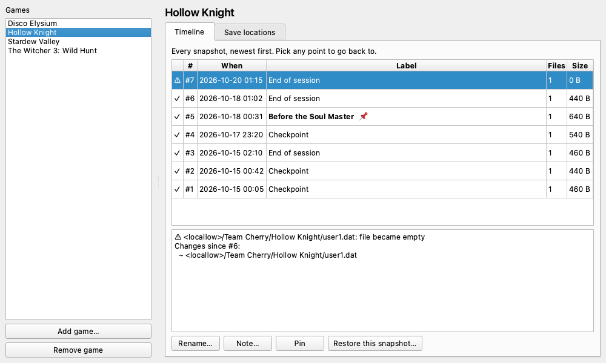
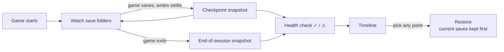

<h1 align="center">SaveIX</h1>

<p align="center">
  <b>Automatic, versioned backups of your PC game saves.</b><br>
  Never lose a 60-hour playthrough to a corrupted save file again.
</p>

<p align="center">
  
  
  
</p>

<p align="center">
  
</p>

## Why

Many PC games keep your progress only in a file on your PC. When that file gets
corrupted (by a crash, a power cut, a bad update or a full disk), the progress is gone.
Cloud sync doesn't save you either: it happily syncs the broken file.

SaveIX runs quietly in the background. It notices when you play, keeps a **timeline of
your saves** as you progress, warns you when a save looks damaged, and lets you put back
**any earlier point**, whether that's the last good save or the moment before a big decision.

It is built for games whose progress lives on your PC: offline, single-player, story-driven
and DRM-free games, whatever store or launcher they came from. Games that keep your progress
on their own servers don't need it.

## Features

- **Automatic while you play.** SaveIX spots the game starting and snapshots your saves
  each time the game saves (once the writing has settled) and again when you quit.
  It even notices when a game crashes.
- **A timeline, not just "the latest backup".** Every snapshot is restorable. Name the
  important ones ("Before the final boss"), add notes and pin them so they are kept forever.
- **Damaged saves are flagged.** Saves that suddenly become empty, all zeros, a fraction of
  their size or unreadable (JSON, XML, SQLite, zip, gzip, Unreal saves) are marked ⚠, and
  the last healthy snapshot is always kept.
- **Restores you can undo.** Before restoring, your current saves are snapshotted, so you
  can always go forward again. SaveIX refuses to restore while the game is running.
- **Small, even after hundreds of hours.** Unchanged files are stored once and everything is
  compressed. Old history is thinned by how much you *play*, not by the calendar.
- **Finds your saves for you.** Search a database of 20,000+ games, let SaveIX watch
  which files a game writes while you play, point it at the game's folder, or just browse.
- **Handles games that save in several places.** One game can have any number of
  folders, files, patterns and registry keys, and they are always captured together.
- **Portable backups.** Locations are stored as `<appdata>/…`, `<documents>/…`,
  `<install>/…`, so backups restore on a new PC or after reinstalling.
- **No admin rights, no hooks into games.** SaveIX only reads the process list and
  your save files. It never touches game memory, so it is safe alongside anti-cheat.
- **A second copy.** Point `mirror_dir` at a OneDrive or external-drive folder and all
  backups are copied there after every session.
- **Tray app, window and command line.** Use whichever you like; they share everything.

## How it works



1. **Each game has save locations:** folders, single files, glob patterns such as
   `*.sav`, or registry keys under `HKEY_CURRENT_USER`. Each one is a `save` or a `config`
   location, with optional include and exclude filters.
2. **SaveIX watches for the game's process.** It recognises the game by its executable
   name, or by any program started from the game's install folder.
3. **During a session,** save folders are watched. When the game writes its save, SaveIX
   waits until the writing has stopped (10 seconds by default) and takes a checkpoint. It
   takes at most one checkpoint every 10 minutes per game; anything newer is caught by the
   next one or by the snapshot taken when you quit. Changes to config files never trigger a
   snapshot by themselves.
4. **Snapshots are content-addressed:** each distinct file is stored once, compressed with
   zstd, and verified when restored. If nothing changed, no snapshot is stored.
5. **History is thinned after each session:**
   - The last 3 sessions keep every checkpoint.
   - Older sessions keep only their final state: one snapshot per day for the 30 most
     recent days you played, then one per week.
   - Pinned, labeled, latest and last-healthy snapshots are never removed.

   A 100-hour game ends up with tens of restore points instead of thousands.

## Installation

### Windows installer

Download `saveix-setup-<version>.exe` from the
[Releases](../../releases) page and run it. It installs for your user only (no admin
rights needed) and can start SaveIX with Windows.

### From source

Requires Windows 10 or 11 and [uv](https://docs.astral.sh/uv/).

```powershell
git clone <this repository>
cd saveix
uv sync --all-extras
uv run saveix tray        # tray app
uv run saveix gui         # window only
uv run saveix --help      # command line
```

## Quick start

### With the app

1. Start **SaveIX**. It lives in the system tray; double-click the icon to open it.
2. Click **Add game…** and type the game's name.
3. Give it its save locations, in whichever way suits you:
   - **Find in database…** searches the optional save database and ticks the locations
     that exist on your PC.
   - **Detect while playing…** watches while you play and save once, then shows the
     folders the game wrote to.
   - **Add folder…**, **Add file…** or **Add registry key…** if you already know where
     the saves are.
   - **Set install folder…** for games that save inside their own folder. SaveIX also
     reads the game's store ID from its files.
4. Play. Snapshots appear on the game's **Timeline** tab.
5. To go back, select any snapshot and click **Restore this snapshot…**.

### With the command line

```powershell
saveix game add "Hollow Knight"
saveix source add "Hollow Knight" "$env:USERPROFILE\AppData\LocalLow\Team Cherry\Hollow Knight"
saveix game add-exe "Hollow Knight" hollow_knight.exe
saveix run                                  # watch for play sessions (Ctrl+C to stop)

saveix timeline "Hollow Knight"             # every snapshot, newest first
saveix label 12 "Before the final boss"
saveix diff 12                              # what changed since the snapshot before it
saveix restore "Hollow Knight" --snapshot 12
```

## Finding save locations

| Way | Command | Best for |
| --- | --- | --- |
| Save database | `saveix suggest GAME` | Well-known games |
| Watch while playing | `saveix detect GAME` | Anything the database doesn't know |
| Game folder | `saveix identify FOLDER --game GAME` | Games that save next to the game, or copies running on a Steam emulator (`saveix emulators GAME`) |
| By hand | `saveix source add GAME PATH` | When you already know the location |

### Optional save databases

Save databases are plugins ("providers"). SaveIX works fully without them, and they can
be turned on, swapped or removed at any time:

```powershell
saveix providers list
saveix providers enable ludusavi
saveix providers update        # downloads the database
saveix suggest "Hollow Knight"
```

- **`ludusavi`** uses the [Ludusavi manifest](https://github.com/mtkennerly/ludusavi-manifest),
  a community database built from [PCGamingWiki](https://www.pcgamingwiki.com/). Missing or
  wrong locations are fixed on PCGamingWiki.
- **`launchers`** finds games installed through Steam, the Epic Games Launcher and GOG, along
  with their install folders and executables.

## Settings

Change settings with `saveix config set KEY VALUE`, and see them all with `saveix config show`.

| Setting | Default | Meaning |
| --- | --- | --- |
| `backup_root` | `%LOCALAPPDATA%\saveix\backups` | Where snapshots are stored. A second drive is a good choice. |
| `quiet_period_seconds` | `10` | How long save writing must stop before a checkpoint |
| `checkpoint_interval_minutes` | `10` | Minimum time between checkpoints (per game: `saveix game set-interval`) |
| `recent_sessions_kept` | `3` | Sessions that keep every checkpoint |
| `keep_all_snapshots` | `false` | Never thin out history |
| `max_snapshots_per_game` | `0` | Optional limit per game (0 = none) |
| `max_storage_mb` | `0` | Optional limit for all backups (0 = none) |
| `providers` | | Enabled save databases |
| `mirror_dir` | | A second folder kept as a copy of all backups (`saveix mirror`) |

Pinned, labeled, latest and last-healthy snapshots are kept even when a limit is reached;
SaveIX warns you instead.

Everything SaveIX stores lives in `%LOCALAPPDATA%\saveix`: the settings, the catalog
database, the backups (unless moved) and the log file. Set `SAVEIX_HOME` to use another
folder.

## Command reference

| Command | What it does |
| --- | --- |
| `game add / list / show / remove` | Manage the library |
| `game set-install`, `add-exe`, `remove-exe` | Tell SaveIX where a game is installed and how it runs |
| `game set-interval`, `set-cloud`, `running` | Per-game checkpoint gap, cloud-sync warning, what's running now |
| `source add / remove` | Save locations (folder, file, glob, registry key) |
| `scan GAME` | Files a game's locations cover right now |
| `backup GAME` | Take a snapshot now |
| `timeline GAME`, `diff A [B]`, `check SNAPSHOT` | Browse history and health |
| `label`, `note`, `pin`, `unpin` | Mark game stages and keep them forever |
| `restore GAME [-s SNAPSHOT] [-S SOURCE] [--dry-run]` | Put back any snapshot, or one location of it |
| `run`, `tray`, `gui` | Background watching, tray app, window |
| `autostart on/off` | Start with Windows |
| `prune [--dry-run]` | Apply retention rules and free unused space |
| `mirror [FOLDER]` | Copy all backups to a second folder |
| `detect`, `identify`, `emulators`, `suggest`, `search` | Find save locations |
| `providers list / enable / disable / update` | Optional save databases |
| `config show / set` | Settings |

Every command has `--help`.

## Limitations

- **Windows only.** The core is cross-platform Python, but known-folder lookups, the
  registry, autostart and the installer are Windows-specific.
- **Local saves only.** Progress kept on a game's servers is out of scope.
- **Cloud-synced games.** For games that also use Steam Cloud or similar, SaveIX warns
  before restoring: the service may offer its own copy, and you should choose the local files.
- **Microsoft Store and Game Pass** games keep saves in encoded containers. These are backed
  up as files but are not well tested.
- The list of Steam emulator save folders is community-reported and may be incomplete.

## Development

```powershell
uv sync --all-extras            # environment with GUI and database extras
uv run pytest                   # tests (Qt tests run headless)
uv run ruff check .             # lint
uv run ruff format .            # format
```

```
src/saveix/
  core/           backup engine: paths, catalog, store, snapshots, sessions, retention…
  integrations/   optional provider plugins (ludusavi, launchers)
  cli/            command line (Typer)
  ui/             tray app and window (PySide6)
packaging/        PyInstaller spec and Inno Setup installer script
```

**Architecture rule:** `core` never imports from `integrations`, and a test enforces it.
Providers talk to the core only through the interface in `core/providers.py` and register
themselves through the `saveix.providers` entry point group. That is all a third-party
plugin needs, too.

### Building the installer

On Windows, with [Inno Setup 6](https://jrsoftware.org/isinfo.php):

```powershell
uv sync --all-extras --group build
uv run pyinstaller packaging/saveix.spec --noconfirm
iscc packaging\installer.iss          # writes dist\installer\saveix-setup-<version>.exe
```

The **Build Windows installer** workflow does the same in GitHub Actions on a `v*` tag or
when started by hand.

## Contributing

Issues and pull requests are welcome, especially:

- save locations that SaveIX misses (for well-known games, please also fix them on
  [PCGamingWiki](https://www.pcgamingwiki.com/) so every tool benefits);
- confirmed Steam emulator save folders (`src/saveix/core/data/emulators.json`);
- reports of games where checkpoints or health checks misbehave.

Please run the tests and `ruff` before opening a pull request, and keep one change per commit.

## Acknowledgements

- [Ludusavi](https://github.com/mtkennerly/ludusavi) and its manifest, which made it
  realistic to know where thousands of games keep their saves.
- [PCGamingWiki](https://www.pcgamingwiki.com/), whose contributors document those locations.

## License

[MIT](LICENSE) © 2026 Rayan Mansoor
